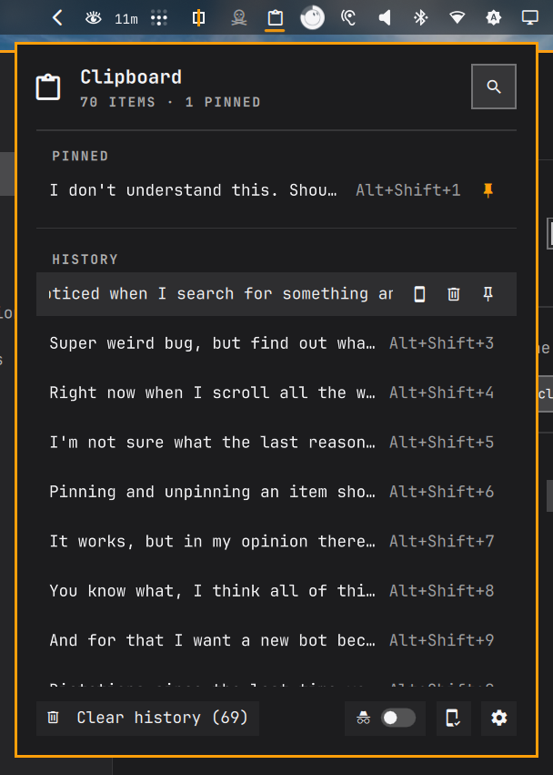

# Nice Clipboard

## TL;DR for humans

A clipboard history for [Omarchy](https://omarchy.org) that looks like it ships with it.

- **Flux integration:** send any item to your phone, see what came from it, and incognito pauses phone sync.
- **Paste queue:** pick several items in order, then paste them one after another.
- **Nice shortcuts:** Alt+V opens it, Alt+Shift+1–0 pastes your pins and newest items from anywhere, everything works from the keyboard.
- **Screenshot text recognition (OCR):** copy the text out of any copied screenshot.
- **QR code recognition:** open a QR link, or copy a Wi-Fi password straight from a QR code.
- **Omarchy theme colours:** follows your current theme, popup sits under its bar icon.
- **Incognito mode:** saves nothing while it's on.
- **Paste as Markdown:** copied web or Docs formatting pastes as clean Markdown.
- **Smart search:** regex plus filters like `type:image`, `app:firefox` or `today`.
- **Pinned items** that never expire, and **password-manager copies are never stored**.

<!-- Preview image goes here, e.g.  -->

It is built on Omarchy's own clipboard manager (`omarchy.clipboard`) and
**replaces** it as a clone (`"clonedFrom": "omarchy.clipboard"`), so there is
only ever one clipboard watcher running. Your existing stock history is
imported once on first start. To hear about upstream changes, run
`omarchy-upstream-drift` after `omarchy update`: it lists what Omarchy changed in its stock clipboard since this copy.

# Details for Agents

## Requirements

- Omarchy 4 (the Quickshell-based shell) with `wl-clipboard`.
- Optional: `zxing-cpp` (or `zbar`) to read QR codes in copied images,
  `tesseract` plus language data for "Copy text from screenshot",
  `python` for Paste as Markdown, and [Flux](https://github.com/bjarneo/flux)
  for phone sync. Everything else works without them.

## Behaviour

- **History:** newest first, a re-copied item moves to the top. Unpinned items
  are deleted 1, 2, 5 (default), 10 or 20 days after they were copied (pick it
  in settings); pinned items are never deleted. Day headings: History (today),
  Yesterday, then the date. Text and images (PNG, JPEG, WebP, GIF,
  …); copied files show their file name and an image preview.
- **Pinned:** shown in their own section at the top, survive "clear history"
  and the limit.
- **Popup:** opens right under the clipboard icon in the bar, like the stock
  Wi-Fi popup (same look, the bar's open-panel underline under the icon,
  click outside or open another bar popup to close),
  also when opened with Alt+V. Without the bar icon (bar widget not in the
  layout) it opens at the top-left corner. A compact list, no preview pane;
  hover or select a row for its actions: edit (text items), phone (send), trash, pin.
- **Edit an item.** The pencil button on a text row turns the row into a
  text field with the whole text. Enter or the check button saves into the
  same item, so its pin, place and copy time stay. Shift+Enter adds a line,
  Esc cancels. The clipboard is not changed. Pick the item to paste the new
  text.
- **Size:** the popup scales with the screen: full size from 1080 px logical
  height up, down to 85% on small laptop screens.
- **Touchpad momentum:** a quick two-finger flick keeps the list scrolling
  after the fingers lift and slows down, like GTK apps and browsers. Mouse
  wheel notches scroll a fixed step.
- **Header.** It uses the stock `PanelHero` and `PanelSeparator`, like the
  Wi-Fi, Bluetooth and Display popups. The clipboard icon sits top left,
  "Clipboard" is in the title size, and a caps line under it shows
  `54 items · 3 pinned` or "Incognito · nothing is saved". The search button
  sits on the right. While you search, the field takes the title's place.
- **Footer (one row):** Clear history on the left; the Incognito switch, a
  phone button (only when Flux is installed) and a gear icon on the right.
  The phone button's icon and tooltip show the Flux state ("<phone> connected
  via Flux", "No phone connected", "Flux paused (incognito)", "Flux not
  running"); clicking it closes the popup and opens Flux (`flux-cli open`). The gear opens the settings
  window (about 900 × 650, tiled like Flux; the popup closes): a sidebar of
  sections (with "Settings" and the version on top) and one section at a time
  on the right, with its title and a short description: General (incognito,
  what a left click does, check for updates), History (delete after, clear right there in the window), Phone (Flux) (what Nice Clipboard adds to Flux, phone, last sync, "Send
  current clipboard"), Text recognition (OCR) (its page: "Languages for text recognition (OCR)"), Search filters,
  Shortcuts, Feedback, and a GitHub link at the bottom of the sidebar. ↑ ↓ pick a section, Esc closes. Closing it any other
  way (Super+W, the window's close button) works too; the gear opens it again.
- **Flux state on the phone button:** a phone with a check when a phone is
  connected, a crossed-out phone otherwise (paused: accent colour). Hovering the phone action
  of a row shows "Send via Flux": it sends only that item to the phone
  (straight to fluxd), your computer's clipboard and the history order stay
  as they are.
- **Incognito:** nothing new is saved (text or images) until you turn it
  off; a small "Incognito" badge in the popup shows it. Survives a restart.
- **Incognito pauses Flux too:** if [Flux](https://github.com/bjarneo/flux)
  (`fluxd.service`) runs, incognito stops it, so copies are not synced to
  the phone or saved in Flux's history; turning incognito off starts it
  again. The footer phone button then shows a crossed-out phone, and the notification says "Flux sync paused". See "Flux" below.
- **Deleting an item** only removes it from the history; the current
  clipboard stays as it is, even when it holds the same text. ("Clear history"
  still empties the clipboard if it held an unpinned item.)
- **Skipped automatically:** copies from password managers
  (`x-kde-passwordManagerHint`, `CLIPBOARD_STATE=sensitive`), text over 4 MiB,
  images over 25 MiB.
- **Storage:** only `~/.local/share/timon.clipboard/` (folder `0700`, files
  `0600`): `history.json`, `state.json`, `images/`, plus the marker
  `~/.local/state/timon.clipboard/flux-paused` while this plugin has Flux
  paused. Nothing is logged, synced or sent anywhere. Unreferenced images are deleted automatically.
- Clipboard text is read by index from that file, never passed on a command
  line, so it does not show up in process lists. Search text copied with
  Ctrl+C goes to `wl-copy` over stdin for the same reason, and stays on the
  clipboard after the popup closes.

- **From phone:** with Flux, text that came from the phone gets a small
  "From phone" label, and the footer phone button shows a phone while a paired
  phone is online.

Bar icon: add `{ "id": "timon.clipboard" }` to a bar section (for example the
right section, before the audio icon). It uses the standard
fixed-width bar icon slot, so switching icons never shifts its neighbours.
Left click opens / closes the history, right click toggles incognito, and it
turns into the incognito icon (󰗹) while incognito is on. It has no hover tooltip.

## Text in images, QR codes and search filters

- Images are read in the background (niced): text with `tesseract`
  (English, plus German when `tesseract-data-deu` is installed) and QR codes
  with `zbarimg`. The text is searchable. Hovering an image row shows
  **Copy text**; a QR link or e-mail gets the open button, a Wi-Fi QR code
  copies the password, any other QR code copies its text. Without the tools
  the buttons simply don't appear: `sudo pacman -S tesseract tesseract-data-eng tesseract-data-deu zbar`.
- OCR languages (Settings > Text recognition (OCR)): every installed
  language is a row with its size on disk, an **in use** switch and
  **Remove**. Images are read in every language that is in use (all
  installed ones by default; at least one stays on; `OMARCHY_OCR_LANGS`, if
  set, decides instead, like Omarchy's own text capture). Remove opens the
  terminal with `sudo pacman -R tesseract-data-<code>` and waits for Enter;
  a pack something else needs is kept and says why (English: "Needed by
  omasnap", Omarchy's screenshot tool), and so is the last language
  (tesseract needs one). Below, **Add language** lists the other common
  languages with their download size; a click installs one. Sizes come
  from the local pacman database (`pacman -Si` / `-Qi`, read when the
  settings window opens); nothing is shown when pacman has no data. Omarchy's floating terminal opens with the plugin's
  `ocr-install.sh`, which first shows what it will run, e.g. "Nice Clipboard
  will install German text recognition: `sudo pacman -S --needed
  tesseract-data-deu`", and waits: Enter continues (then sudo asks for your
  password), Ctrl+C cancels. pacman installs the signed Arch package, which
  then gets updated with the rest of your system. When it is done the window
  says so and closes after 5 s. The plugin never holds root. It re-reads the installed languages every 3 s until the new one
  shows up and then says so.
- Missing languages are suggested: the plugin looks (read-only) at your
  locale, Hyprland keyboard layouts and hunspell dictionaries. A small
  banner at the top of the popup says e.g. "Based on your keyboard layout:
  install text recognition (OCR) for German?" with **Install** and **Not
  now**; settings show the same. Not now hides it for good (both places).
  To see the banner on a machine where nothing is suggested (developer
  test): `omarchy-shell shell call timon.clipboard ocrBannerDemo x` (or a code
  like `fra`), then open the popup; it goes away with Not now or when the
  popup closes, and nothing is saved. To bring back real suggestions you
  dismissed: `f=~/.local/share/timon.clipboard/state.json; jq '.ocrDismissed = []' "$f" > "$f.new" && mv "$f.new" "$f"`
  (the plugin watches that file and picks it up right away).
- Search filters, combinable with normal search text: `type:image|screenshot|text|link|color|file`,
  `app:<window class>` (recorded from 1.16.0 on), `is:pinned`, `today`, `yesterday`, `<30m`, `<2h`, `<3d`.

## Paste as Markdown, paste queue, password managers

- **Paste as Markdown:** a copy from a browser or office app also carries
  HTML. When it has formatting (headings, links, lists, bold/italic, code,
  quotes, tables) the HTML is kept with the entry (up to 256 KiB) and the row
  shows a Markdown button (󰍔, "Paste as Markdown"). It converts with
  `pandoc -t gfm` when pandoc is installed, else with the bundled
  `html2md.py` (Python standard library, handles Google Docs' styled
  spans); if neither works it pastes the plain text.
- **Paste queue:** Ctrl+click rows (or Ctrl+Space on the selected one); each
  gets a numbered badge in click order. The footer's Clear history button
  shows "Paste queue: N items in order"; closing the popup starts the queue. Esc clears the selection first.
  Starting closes the popup and shows a notification titled "Paste queue ready:"
  with body "Paste 1 of N. Esc cancels.". Every Super+V (or Ctrl+V) then pastes
  the next item and updates the same notification ("Pasted 1 of 4. Super+V pastes
  2 next. Esc cancels."); after the last one it says "Pasted N of N. Done.".
  Esc cancels (and still reaches the window), so does the footer
  button "Pasting k of N · Cancel" when you open the popup again, and a
  queue ends by itself after 15 minutes without a paste.
  How it works: while a queue runs, `queue.sh` binds Super+V, Ctrl+V and Esc at
  runtime (`hyprctl eval 'hl.bind(...)'`, removed with `hl.unbind` when it
  ends). Super+V or Ctrl+V puts the next item on the clipboard and sends
  Shift+Insert, the same way Alt+Shift+N does. When the queue ends (done, Esc,
  a new pick, the watchdog), Super+V gets Omarchy's universal paste back
  (Shift+Insert in terminals, Ctrl+V elsewhere). A Hyprland config reload also
  restores it. Only Super+V and Ctrl+V advance the queue (Ctrl+Shift+V in a
  terminal pastes the current item without advancing). Detecting pastes from the
  clipboard itself (`wl-copy --paste-once`) does not work here: every clipboard
  watcher (this plugin, Flux) reads each copy and would use the paste up.
- **Password managers:** copies marked `x-kde-passwordManagerHint` are never
  stored. Bitwarden desktop sets it on Linux for copied passwords (since
  2025, through arboard's `exclude_from_history`), as do KeePassXC and
  `wl-copy --sensitive`; wl-paste 2.3.0 then reports `CLIPBOARD_STATE=sensitive`,
  which Flux also honours, so these copies are not sent to the phone either.
  No guessing from window titles or browser fields.

## Feedback

Settings > Feedback: type an idea, bug or wish and press Enter or Send
(Shift+Enter starts a new line). The text is posted to the Nice Clipboard feedback Worker at
`https://feedback.roehrbacher.com/feedback` (a Cloudflare Worker that files it
as an issue in a private repo; rate limited, no IP stored) and the box says
"Feedback sent, thanks! Timon reads every message." with Omarchy's check icon, on its own line under Send. No browser, no GitHub account. Only the text and the plugin
version are sent. If sending fails, the text stays in the box. The page also
links the [GitHub page](https://github.com/roehrbacher/Nice-Clipboard).

## Privacy

History stays on this computer in `~/.local/share/timon.clipboard/`
(folder `0700`, files `0600`). Nothing is logged, synced or sent anywhere by
this plugin; the exceptions are feedback (what you type in Settings >
Feedback goes to `https://feedback.roehrbacher.com/feedback`, and only when
you press Send) and the optional update check (off by default, see Update). Password-manager copies are never stored, and incognito mode
stores nothing. Phone sync only happens if you run Flux yourself, and
incognito pauses it.

## Flux

`fluxd` watches the clipboard itself (its own `wl-paste --watch`) and has no
pause switch of its own that fits: its `autoClipboard` setting would still keep
the last incognito copy in memory and hand it to the phone when it reconnects,
and it would change Flux's config file. So `flux-pause.sh` simply stops and
starts Flux's systemd user unit (`systemctl --user stop|start fluxd.service`).
Nothing of Flux (binary, unit, config) is touched, so a Flux update cannot undo
this. When fluxd starts again it records the current clipboard without sending
it, so nothing copied during incognito reaches the phone.

The phone keeps what you send from it while fluxd is stopped, and delivers
it as soon as Flux is back. Flux has no way to drop it. So after incognito
ends, new text waits until `flux-cli status` says where it came from. This
lasts until 5 s after the phone is online again, at most 10 minutes. Text from
the phone is not saved and the clipboard is cleared. Other text is saved as
usual. Flux's own history still lists the phone item.

- Flux is only started again if this plugin stopped it (marker file in
  `~/.local/state/timon.clipboard/`). If Flux was off already, or you ran
  `flux-cli off` meanwhile, it stays off.
- Every shell start runs the same sync: if incognito ended while the shell
  was down (crash, reboot), Flux is started; if incognito is still on after
  a reboot, the fluxd that systemd started at login is stopped again.
- Uninstalling (`clipboard.sh wipe`) starts Flux first if we paused it.
- No Flux installed: nothing happens, nothing is logged.
- While paused, the whole phone link is down (notifications, SMS, calls, file
  transfer, phone approval of sudo), and Flux's own bar icon says "fluxd is not
  running". That is the price of a clean pause; it comes back with incognito
  off. Starting Flux from its own panel during incognito is allowed and
  sticks until the next incognito toggle or shell start.

By hand: `flux-pause.sh status` (`paused`, `running`, `off`, `absent`),
`flux-pause.sh resume` (start Flux if we stopped it).

IPC (for scripts): `omarchy-shell shell call timon.clipboard toggleIncognito x`,
`setIncognito on|off`, `status x` (includes `incognito` and `fluxPaused`). The
older names `togglePrivate` and `setPrivateMode` still work.


## Shortcuts

| Key | What it does |
|---|---|
| **Alt+V** | open / close clipboard history |
| Super+Shift+V | the same (GNOME default key, optional binding) |
| Super+Ctrl+V | the same (stock Omarchy key, routed to this plugin) |
| **Super+Shift+Ctrl+V** | incognito on/off from anywhere (with a notification) |
| Alt+Shift+1–0 | (added by the plugin, see Install) paste slot 1…10 from anywhere: your pinned items first (in their order), then the newest history items fill the rest. With 4 pins, Alt+Shift+5 is the newest history item and Alt+Shift+0 the 6th. (runs `paste-slot.sh`; closes the popup first if it is open) |

In the popup:

| Key | What it does |
|---|---|
| type | search (case-insensitive regex; invalid regex = plain text) |
| ↑ ↓ / Ctrl+K Ctrl+J, PgUp PgDn, Home End | move through the list |
| Enter / click | paste into the window you came from (click: per Settings > General > "When you left-click an item": Copy only, Copy, paste and close (default), or Copy, paste and keep open: the popup closes for the paste and opens again with the same search) |
| Shift+Enter | copy only (select it without pasting) |
| Alt+Enter | open (URL in browser, text in editor, image in editor) |
| Ctrl+click / Ctrl+Space | add the row to the paste queue (numbered 1, 2, 3 …); again takes it out |
| Ctrl+click / Ctrl+Space 2+ items, then close the popup (Enter, click, Esc twice or click outside) | start the paste queue: every Super+V (or Ctrl+V) pastes the next item, Esc cancels |
| Alt+Shift+1–0 | paste slot N, the same item as from anywhere (also while searching); the 10 slotted rows show their key |
| → / ← (search cursor at the end) | move between the selected row's actions (phone, trash, pin); Enter presses the focused one; Esc, ↑ or ↓ go back to the row |
| Ctrl+P (or the pin icon) | pin / unpin (Ctrl+F works too) |
| Delete (or the trash icon) | delete the item (with search text selected: delete that text). The trash icon asks first: one click turns it red with a check, a second click deletes (it resets after 3 s, when the mouse leaves it or the popup closes). Del on the keyboard deletes an unpinned item at once and arms a pinned one the same way |
| Ctrl+Z | bring back the last deleted item (up to 10, in this session), at its place and with its pin; with nothing to bring back it edits the search |
| Ctrl+S (or the phone icon) | send a text item to the phone (Flux, when a phone is connected); in Settings > Phone (Flux): send the current clipboard |
| Shift+Delete | clear history (asks first; only unpinned items are counted and deleted, pinned items stay) |
| Ctrl+I (or the Incognito switch in the footer, or right-click the bar icon) | incognito on/off |
| Backspace, Ctrl+Backspace, ← → | edit the search |
| Ctrl+U | clear the search |
| Shift+← → / Shift+Home End, Ctrl+A, mouse drag | select search text |
| Ctrl+C / Ctrl+X (with search text selected) | copy / cut it to the clipboard (becomes a new history item) |
| Ctrl+V | paste into the search |
| the gear icon in the footer | open the settings window (↑ ↓ pick a section, Esc closes) |
| Esc | clear the search, then close |

## Install

```bash
omarchy plugin add https://github.com/roehrbacher/Nice-Clipboard --enable
```

The plugin ID is `timon.clipboard`. Enabling it switches off the stock
`omarchy.clipboard` (it is a clone of it), so only one clipboard watcher runs.
Alt+V and Alt+Shift+1–0 work right away: the plugin adds them to the
running Hyprland itself (Settings > Shortcuts > System-wide shortcuts, on by
default). No config file is edited. They are added again after every
Hyprland config reload, only on keys that are still free (a key your config
already uses is left alone and listed there), and removed when you switch the
setting off or disable / remove the plugin. Optional extra keys go in
`~/.config/hypr/bindings.lua`:

```lua
o.bind("SUPER + SHIFT + V", "Clipboard history", "omarchy-shell shell toggle timon.clipboard")  -- optional, GNOME key
o.bind("SUPER + SHIFT + CTRL + V", "Clipboard incognito", "omarchy-shell shell call timon.clipboard toggleIncognito x")
```

and run `omarchy restart shell`.

## Update

Omarchy menu > Update (`omarchy-update`) updates Omarchy and your packages,
not third-party plugins. A plugin installed with `omarchy plugin add` (a git
clone) is updated with:

```bash
omarchy plugin update timon.clipboard && omarchy restart shell
```

(it fetches, shows the changes and asks first; while the repository is
private this needs GitHub access). A copied install (no `.git` folder) is
updated by copying the new version over it. The plugin is `keepLoaded`, so
code changes need a shell restart.

**Check for updates** (Settings > General, **off by default**): when on, at
most once a day when the popup opens, `update-check.sh` asks the public
GitHub API for the newest release (or version tag) of
`roehrbacher/Nice-Clipboard`: an anonymous request with a fixed user agent,
no token, nothing about you or this computer. If it is newer than the
installed version, a small "New update available" note at the top of the
popup says how to update (with GitHub page and Hide). If the repository
is private, offline or has no release, nothing is shown. Saved in
`state.json` (`updateCheck`, last check time, newest version seen).

## Uninstall

Settings > Uninstall has two buttons (each asks with a second click, then
opens a terminal that shows every command and waits for Enter):
**Uninstall plugin** (its runtime keys, history, settings and the plugin;
Flux is resumed if incognito paused it) and **Uninstall plugin and
languages** (also the OCR packs Nice Clipboard installed itself, recorded in
`~/.local/share/timon.clipboard/ocr-installed`; packs that were there before
or that something else needs stay). By hand:

```bash
~/.config/omarchy/plugins/timon.clipboard/flux-pause.sh resume   # start Flux again if incognito had paused it
omarchy plugin remove timon.clipboard      # brings back the stock omarchy.clipboard
rm -rf ~/.local/share/timon.clipboard      # optional: deletes the saved history
omarchy restart shell
```

Remove any bindings you added yourself too (the plugin's own Alt+V and
Alt+Shift+1–0 go away with it). Super+Ctrl+V then opens the stock manager again.
To only switch it off and keep it installed: `omarchy plugin disable timon.clipboard`.

## Tests

```bash
node tests/history.test.js     # history model: limit, pins, search, clear, key routing, count label, delete confirm, Ctrl+N, Alt+Shift slots, popup size, Flux origin, phone name, last sync, phone button state and tooltip
QT_QPA_PLATFORM=offscreen /usr/lib/qt6/bin/qmltestrunner -input tests/tst_searchfield.qml  # search field keys, pinned Del twice (real Qt)
QT_QPA_PLATFORM=offscreen /usr/lib/qt6/bin/qmltestrunner -input tests/tst_kinetic.qml      # wheel step, touchpad 1:1, momentum after lift-off
bash tests/capture.test.sh     # capture: incognito, password hint, size caps, 0600/0700, import, prune
bash tests/flux-pause.test.sh  # Flux pause/resume with a stub systemctl (never touches the real fluxd)
bash tests/queue.test.sh       # paste queue (stub hyprctl / wl-copy / notifier), incl. quiet cancel
bash tests/version.test.sh      # Clipboard.qml version (sent with feedback) = manifest = CHANGELOG
bash tests/ocr-hints.test.sh    # OCR language hints from locale / LANGUAGE / locale.conf / keyboard layout (stub hyprctl)
bash tests/ocr-install.test.sh  # OCR install script: shows the command, waits for Enter, rejects odd codes, reports how it ended (dry run, no sudo)
bash tests/global-keys.test.sh  # plugin-added global keys: only free keys bound, taken ones reported, remove drops only ours (stub hyprctl)
bash tests/send.test.sh         # Send via Flux: fluxd socket only, no wl-copy, history untouched (fake fluxd)
bash tests/slots.test.sh        # Alt+Shift slots: copy-slot / paste-slot.sh (and old paste-pinned.sh) = the popup's mapping
bash tests/uninstall.test.sh    # uninstall.sh: shows every step, waits for Enter, only removes recorded, unneeded languages (fake HOME, stubs)
bash tests/geometry/run-harness.sh v129 # offscreen: slot hints and keys, demo banner, settings window reopen after Super+W, feedback sent state
bash tests/geometry/run-harness.sh v130 # offscreen: update check off / on (stub), OCR sizes, sidebar link, feedback note at 940 and 620 px
bash tests/geometry/run-harness.sh v131 # offscreen: delete confirm, Ctrl+Z undo, General / History / OCR / Uninstall pages (add a dir to keep the PNGs)
bash tests/geometry/run-harness.sh v132 # offscreen: popup header next to the stock PanelHero, edit mode, paste and keep open, settings pages, subtitle sizes, phone quarantine
bash tests/geometry/run-harness.sh v1322 # offscreen: every popup close ends edit / clear question / armed delete; a cancelled OCR job clears its state
```

All tests run offscreen with stubs; none of them touch your real clipboard,
history, Flux or screen.

## Credit

Built on Omarchy's stock clipboard manager (`shell/plugins/clipboard`, MIT,
David Heinemeier Hansson). UX modelled on GNOME Clipboard History by Alex
Saveau (MIT); no code from it is used.

See [CHANGELOG.md](CHANGELOG.md) for what changed in each version.

## License

MIT, see [LICENSE](LICENSE).
